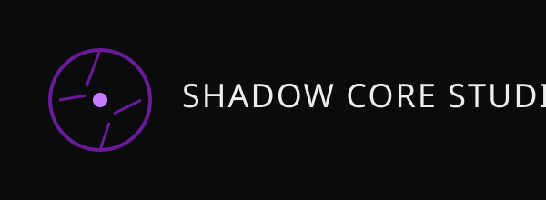

  
  [-blue?style=for-the-badge)](https://mrcode-10.github.io/my-awesome-site/)
  
  

  ---

  [🌐 Official Website](https://mrcode-10.github.io/my-awesome-site/) •
  [📺 YouTube Channel](https://www.youtube.com/@ShadowCoreStudio-i7r) •
  [🎵 TikTok](https://www.tiktok.com/@shadow.game.devel)

 

### 🎮 Main Engine & Core Arsenal

### 🛠️ Game Dev, Architecture & UI/UX

### 🚀 Expanded Realms & Side Quests

 

> *“Forged in code, thriving in Godot Engine, designing complete UI/UX & Databases, producing content, and continuously exploring new tech realms with Dell & ASUS workstations!”* 🚀✨

 

---

### 🌟 Core Focus & Engineering
- **Game Development:** Primary focus on **Godot Engine** (GDScript & C#) for building indie games, custom save/load systems, and gameplay mechanics.
- **UI/UX Design & Architecture:** Designed end-to-end custom user interfaces in **Figma** and structured complex database schemas for applications and game concepts.
- **Content Creation & Video Production:** Self-produced, recorded, and edited all video content for **Shadow Core Studio** across YouTube and TikTok.
- **Hardware & Workstation:** Powered by Linux & Windows environments on robust **Dell Precision** and **ASUS** hardware.

---

### 📊 GitHub Activity & Stats

 

### 🐍 GitHub Contributions Snake

<picture>
  <source media="(prefers-color-scheme: dark)" srcset="https://raw.githubusercontent.com/MrCode-10/MrCode-10/output/github-snake-dark.svg">
  <source media="(prefers-color-scheme: light)" srcset="https://raw.githubusercontent.com/MrCode-10/MrCode-10/output/github-snake.svg">
  
</picture>

